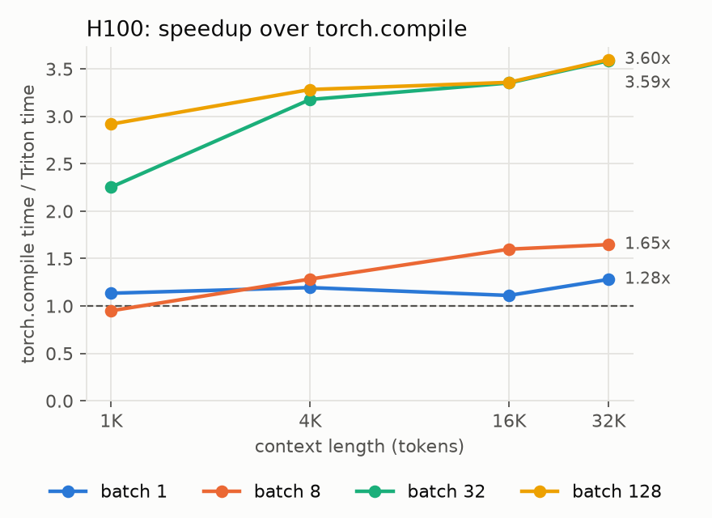
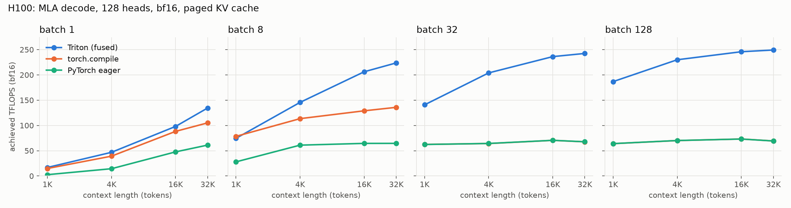

# DeepSeek MLA Triton Kernel

A fused decode kernel for DeepSeek's Multi-head Latent Attention, the attention
used in DeepSeek-V2, V3 and R1. It is written in Triton, OpenAI's Python
language for writing GPU kernels. `torch.compile` still runs MLA as several
separate GPU operations and writes the full attention-score matrix to memory
between them. This kernel does the whole step in one pass over the compressed
KV cache, so at long contexts it runs up to 3.6x faster on an H100.

## Details

- **Setup:** H100 80GB SXM, 128 heads (DeepSeek-V3 on one GPU), bf16, paged
  KV cache. `torch.compile` runs in `max-autotune` mode. Every case is checked
  against a reference before it is timed.
- **Results:** faster than `torch.compile` in 15 of 16 shapes, peaking at 249
  TFLOPS. The one loss is batch 8 at 1K tokens, where launch overhead dominates.
  At batch 32 and above, `torch.compile` was no faster than plain PyTorch.
  Full numbers are in [`results/bench_h100.csv`](results/bench_h100.csv).
- **Install:** `pip install git+https://github.com/luvadlamudi/triton-mla.git`.
  The package provides `mla_decode`, a full `MLA` layer and the
  `triton-mla-bench` command.
- **Limitations:** single-token decode only, no FP8 cache, and no Blackwell
  (B200) support yet.
